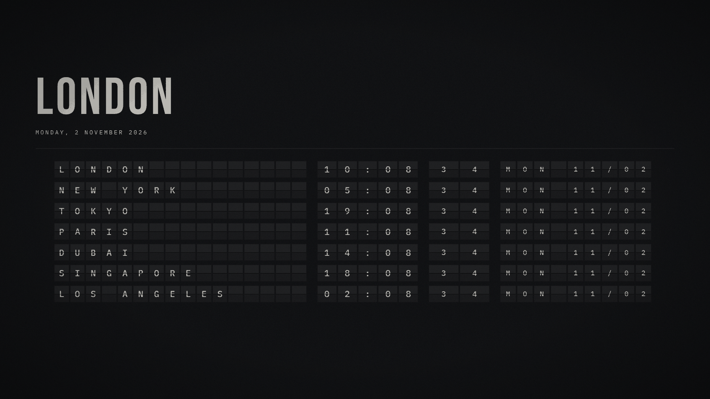
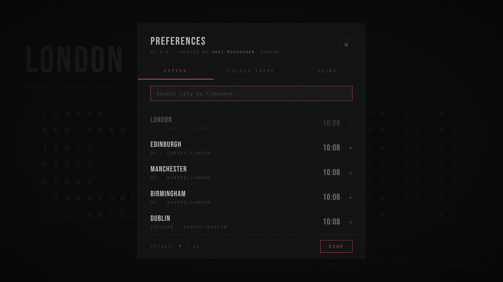

# Split-Flap World Clock

**An airport departure board for the time in your favourite cities.**

[](https://github.com/ShazMoghaddam/split-flap-world-clock/actions/workflows/pages.yml)
[](LICENSE)

Split-Flap World Clock turns a spare laptop, monitor or tablet into a desk clock. Every city sits on its own row of mechanical flaps that clatter over as the minutes change, with synthesised flap sounds, a slow film grain and a tint that warms through the evening. It's one web page with nothing to install, and it runs offline.



**[Open the clock](https://shazmoghaddam.github.io/split-flap-world-clock/clock/)**, then press <kbd>Shift</kbd> + <kbd>F</kbd> for full screen. Or visit the [site](https://shazmoghaddam.github.io/split-flap-world-clock/) for a live preview.

- **Your cities.** Pick up to ten from 290 cities around the world. Your home city comes from your device and always sits at the top; drag the others into any order.
- **Feels mechanical.** Tiles flip when they change, idle tiles twitch now and then, and **F** sends a cascade across the whole board.
- **Sounds right.** Three flap sounds made live with Web Audio (heavy mechanical, plastic rattle, classic airport), with volume and mute. No audio files.
- **Easy on the eyes at night.** The board drifts from a cool daylight white to a dim amber through the evening and back by morning.
- **Fits any screen.** From a small laptop to a 4K monitor, every row fits without scrolling, even with ten cities.
- **Stays awake.** The screen doesn't sleep while the clock is showing, in browsers that support it.
- **Private.** One self-contained file with the fonts built in. No accounts, no tracking, and nothing leaves your device.

## Contents

- [Using the clock](#using-the-clock)
- [As a desk display](#as-a-desk-display)
- [Run it yourself](#run-it-yourself)
- [How it works](#how-it-works)
- [Development](#development)
- [Credits](#credits)
- [Licence](#licence)

## Using the clock

Move the mouse or tap the screen to bring up the controls in the bottom corner. They fade away again after a few seconds.

| Control | Key | What it does |
| --- | --- | --- |
| Gear | | Preferences: cities, colour theme and sound |
| 24H / 12H | | Switches the time format; 12-hour adds an AM/PM badge |
| F | <kbd>F</kbd> | Flips the whole board |
| Full screen | <kbd>Shift</kbd> + <kbd>F</kbd> | Full screen on or off |
| Speaker and VOL | | Mute and volume |
| | <kbd>Esc</kbd> | Closes Preferences |

With the controls showing, each row gets a handle on the left to drag it and a cross on the right to remove it. In Preferences, search by city, country or time zone and click a city to add it. Pick one of nine accent colours and one of three flap sounds. Everything is saved in your browser.

Browsers only allow sound after you've clicked, tapped or pressed a key, so the flaps start clicking after your first interaction.



## As a desk display

- **Laptop or spare monitor:** open the clock, press <kbd>Shift</kbd> + <kbd>F</kbd>, and leave it running.
- **iPad or iPhone:** in Safari, use Share, then Add to Home Screen, and open it from there for a full-screen clock. Turn the device sideways; the board is made for landscape.
- **Offline:** save [`index.html`](app/src/main/assets/index.html) anywhere and open it. It needs no internet connection.

## Run it yourself

The clock is a single file, so you can open `app/src/main/assets/index.html` straight from the repo in any browser.

To preview the whole site exactly as GitHub Pages serves it:

```sh
sh scripts/build-site.sh serve
# then open http://localhost:8000
```

## How it works

The whole clock is one self-contained web page with its fonts embedded and no external requests. The site is a short landing page around it with a live preview. The Pages workflow assembles both into one folder on every push to `main`, so the clock at `/clock/` is always the same file as in the repo.

```
app/src/main/assets/index.html   the clock: markup, styles, city list, flap engine, sound, tint
site/                            the landing page, its styles and fonts
scripts/build-site.sh            assembles the site into _site/ (used by the Pages workflow)
docs/                            README images, social preview and the script that renders them
```

The clock sits inside an Android project because there's also an Android app that shows the same page. To build it, open the folder in Android Studio and run it. Any change to the clock reaches the app the next time it's built.

## Development

There's no build step for the clock: edit `index.html` and reload. See [CONTRIBUTING.md](CONTRIBUTING.md) for adding cities, colours and sounds, and [CHANGELOG.md](CHANGELOG.md) for what changed in each version.

To refresh the README images and social preview after a visual change:

```sh
pip install playwright && playwright install chromium
python docs/capture.py
```

## Credits

Typefaces Bebas Neue and IBM Plex Mono (SIL Open Font License), embedded in the page and served with the site. Designed and built by [Shaz Moghaddam](https://shazmoghaddam.github.io), London.

## Licence

[MIT](LICENSE)

---

**Shaz Moghaddam** · London · [shazmoghaddam.github.io](https://shazmoghaddam.github.io)
